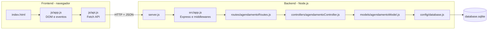

# PartyControl

Sistema de **controle de agendamento de salão de festa**, desenvolvido como projeto prático de CRUD
completo (Criar, Ler, Atualizar e Excluir) com **backend em Node.js + Express + SQLite** e
**frontend em HTML, CSS e JavaScript puro**. A entidade principal é o **Agendamento**.

## Equipe

| Nome | Responsabilidade |
|---|---|
| (preencher) | (preencher) |

## Estrutura

```
PartyControl/
├── backend/
│   ├── src/
│   │   ├── config/
│   │   │   └── database.js            # Conexão com SQLite e criação da tabela
│   │   ├── controllers/
│   │   │   ├── agendamentoController.js # Status HTTP e formato da resposta
│   │   │   └── authController.js      # Cadastro, login, logout e consulta de sessão
│   │   ├── middlewares/
│   │   │   └── autenticacao.js        # Bloqueia rotas sem login válido
│   │   ├── models/
│   │   │   ├── agendamentoModel.js    # Validação, conflito de horário e consultas
│   │   │   └── usuarioModel.js        # Cadastro por Gmail, senha com hash e sessões
│   │   ├── routes/
│   │   │   ├── agendamentoRoutes.js   # Endpoints dos agendamentos
│   │   │   └── authRoutes.js          # Endpoints de autenticação
│   │   ├── utils/
│   │   │   ├── texto.js               # Normalização de texto e busca tolerante a erros
│   │   └── email.js               # Chave canônica do e-mail (detecta Gmail repetido)
│   │   └── app.js                     # Configuração do Express e middlewares
│   ├── server.js                      # Ponto de entrada
│   └── package.json
│
├── frontend/
│   ├── css/styles.css                 # Estilização e layout
│   ├── js/
│   │   ├── api.js                     # Comunicação com o backend e token de sessão
│   │   ├── app.js                     # DOM e eventos do painel
│   │   ├── lobby.js                   # Botões da página inicial conforme o estado de login
│   │   ├── login.js                   # Eventos da tela de login
│   │   └── cadastro.js                # Eventos da tela de cadastro
│   ├── index.html                     # Página inicial (descrição e escolha entre entrar ou cadastrar)
│   ├── login.html                     # Tela de login
│   ├── cadastro.html                  # Tela de cadastro
│   └── painel.html                    # Painel: formulário, filtros e tabela
│
├── .gitignore
└── README.md
```

## Arquitetura em camadas



## Telas e acesso

| Tela | Arquivo | Função |
|---|---|---|
| Início | `index.html` | Página inicial pública: breve descrição do sistema e a escolha entre **Já tenho conta** e **Quero me cadastrar** (os botões **Entrar** e **Cadastrar** também ficam no canto superior direito) |
| Cadastro | `cadastro.html` | Nome, e-mail do Gmail, senha e confirmação de senha |
| Login | `login.html` | E-mail do Gmail e senha |
| Painel | `painel.html` | CRUD dos agendamentos (só com login) |

Fluxo: o visitante chega à página inicial, cria a conta em **Cadastrar** (já entra logado ao concluir) e
nas próximas vezes usa **Entrar**. Quem já está logado vê na página inicial os botões **Ir para o painel** e **Sair**.

**Regras do cadastro:**

- O e-mail deve ser do Gmail (`nome@gmail.com`) e não pode se repetir. Se já houver conta com ele, a tela
  de cadastro mostra a mensagem de erro, marca o campo e oferece o link para o login (API: **409**).
- A checagem segue a regra do próprio Gmail: maiúsculas, pontos e `+etiqueta` não criam outra conta
  (`Ana.Souza@gmail.com`, `anasouza@gmail.com` e `ana.souza+festa@gmail.com` são a mesma caixa).
- A senha deve ter de 6 a 100 caracteres.
- A senha nunca é guardada em texto puro: usa-se hash com `scrypt` e sal individual (módulo `crypto`
  do Node, sem dependência extra). Contas e senhas ficam no `database.sqlite`, na tabela `usuarios`.
- O sistema confere o formato e o domínio do e-mail, mas **não envia código de confirmação**: não
  verifica se a pessoa é de fato dona da conta Gmail. Isso exigiria login com Google (OAuth) ou envio de e-mail.

**Sessão:** ao entrar, o servidor gera um token e o navegador o guarda no `localStorage`. A sessão vale
7 dias ou até clicar em **Sair**. Todas as rotas `/api/agendamentos` exigem o token; sem ele a API
responde **401** e o frontend volta para a tela de login.

Bancos criados em versões anteriores são atualizados sozinhos (a coluna `usuario` passa a se chamar
`email` e é criada a coluna `email_chave`). Contas antigas sem e-mail do Gmail deixam de ser usadas: crie uma nova em **Cadastrar**.

## Entidade Agendamento

| Campo | Tipo | Regra |
|---|---|---|
| `nome` | texto | obrigatório, **único**, 3 a 80 caracteres (maiúsculas e acentos não diferenciam) |
| `cliente` | texto | obrigatório, 2 a 100 caracteres |
| `telefone` | texto | obrigatório, 10 ou 11 dígitos, formatado como `(00) 0 0000-0000` |
| `tipo_evento` | lista | Aniversário, Casamento, Formatura, Chá de bebê, Chá de panela, Confraternização, Batizado, Reunião ou Outro |
| `data_evento` | data | obrigatório, formato `AAAA-MM-DD` |
| `hora_inicio` | hora | obrigatório, formato `HH:MM` |
| `hora_fim` | hora | obrigatório, maior que `hora_inicio` |
| `convidados` | inteiro | maior ou igual a zero |
| `valor` | número | maior ou igual a zero |
| `status` | texto | `pendente`, `confirmado` ou `cancelado` |
| `observacoes` | texto | opcional, até 500 caracteres |

**Regra de negócio principal:** não é permitido dois agendamentos não cancelados com horários que se
sobrepõem na mesma data. Nesse caso a API responde **409**. O mesmo
código 409 é devolvido quando o nome do agendamento já está em uso.

## Pesquisa

O campo **Pesquisar** procura no nome do agendamento, no cliente e no tipo de evento. A busca
ignora maiúsculas, minúsculas e acentos e tolera pequenos erros de digitação (por exemplo,
`aniversrio` encontra "Aniversário" e `casamneto` encontra "Casamento"). A lógica fica em
`backend/src/utils/texto.js` e usa a distância de Damerau-Levenshtein.

## Endpoints

| Método | Rota | Corpo | Sucesso | Erros |
|---|---|---|---|---|
| POST | `/api/auth/registrar` | `{ nome, email, senha }` | 201 + token | 400 validação, 409 e-mail em uso |
| POST | `/api/auth/login` | `{ email, senha }` | 200 + token | 400, 401 |
| POST | `/api/auth/logout` | — (com token) | 204 | 401 |
| GET | `/api/auth/sessao` | — (com token) | 200 + nome e e-mail | 401 |
| GET | `/api/agendamentos` | — (filtros opcionais `?busca=`, `?data=` e `?status=`) | 200 + lista | — |
| GET | `/api/agendamentos/tipos` | — | 200 + tipos de evento | — |
| GET | `/api/agendamentos/:id` | — | 200 + agendamento | 400 ID inválido, 404 |
| POST | `/api/agendamentos` | campos da entidade | 201 + agendamento criado | 400 validação, 409 conflito |
| PUT | `/api/agendamentos/:id` | campos da entidade | 200 + agendamento atualizado | 400, 404, 409 |
| DELETE | `/api/agendamentos/:id` | — | 204 sem corpo | 400, 404 |

As rotas de `/api/agendamentos` exigem o cabeçalho `Authorization: Bearer <token>`.
Todos os erros seguem o formato `{ "erro": "mensagem" }`.

## Como rodar

Requisito: [Node.js](https://nodejs.org) 18 ou superior.

```bash
cd backend
npm install
npm start
```

Abra **http://localhost:3000** (abre a página inicial). O backend também serve o frontend, então tudo roda com um comando.
O terminal precisa continuar aberto com o servidor rodando; se aparecer "NetworkError" ao entrar,
o backend não está no ar. Abrir o frontend por outra porta (Live Server) também funciona, desde que
o backend esteja rodando em `localhost:3000`.
O banco `database.sqlite` é criado automaticamente em `backend/` na primeira execução.

## Testando a API sem o frontend

```bash
curl -X POST http://localhost:3000/api/auth/registrar -H "Content-Type: application/json" \
     -d '{"nome":"Maria Silva","email":"maria@gmail.com","senha":"segredo1"}'
TOKEN=$(curl -s -X POST http://localhost:3000/api/auth/login -H "Content-Type: application/json" \
     -d '{"email":"maria@gmail.com","senha":"segredo1"}' | sed 's/.*"token":"\([^"]*\)".*/\1/')
curl http://localhost:3000/api/agendamentos -H "Authorization: Bearer $TOKEN"
curl -X POST http://localhost:3000/api/agendamentos -H "Authorization: Bearer $TOKEN" -H "Content-Type: application/json" \
     -d '{"nome":"Aniversário da Maria","cliente":"Maria Silva","telefone":"45999998888","tipo_evento":"Aniversário","data_evento":"2026-12-05","hora_inicio":"14:00","hora_fim":"18:00","convidados":50,"valor":1200}'
curl "http://localhost:3000/api/agendamentos?busca=aniversrio" -H "Authorization: Bearer $TOKEN"
curl -X DELETE http://localhost:3000/api/agendamentos/1 -H "Authorization: Bearer $TOKEN"
```

## Fluxo de trabalho no repositório

1. Cada integrante trabalha em uma branch própria (`git checkout -b feature/nome-da-tarefa`).
2. Commits pequenos e com mensagem clara.
3. Pull Request revisado por outro integrante antes de ir para a `main`.
4. O arquivo `database.sqlite` e a pasta `node_modules` não são versionados (ver `.gitignore`).

## Próximos passos sugeridos

1. Cadastro de clientes em tabela separada, relacionada ao agendamento.
2. Visualização em calendário mensal.
3. Variáveis de ambiente com `.env`.
4. Testes automatizados com `node:test` e `supertest`.
5. Login com Google (OAuth) para confirmar de fato a posse do Gmail, e recuperação de senha.
6. Separar os agendamentos por usuário (hoje todos os usuários logados veem os mesmos dados).
