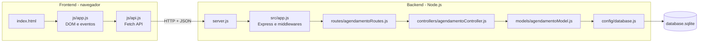

# PartyControl

Sistema de **controle de agendamento de salão de festa**, desenvolvido como projeto prático de CRUD
completo (Criar, Ler, Atualizar e Excluir) com **backend em Node.js + Express + SQLite** e
**frontend em HTML, CSS e JavaScript puro**. A entidade principal é o **Agendamento**.

## Equipe

| Nome | Responsabilidade |
|---|---|
| (preencher) | (preencher) |

## Estrutura

```
PartyControl/
├── backend/
│   ├── src/
│   │   ├── config/
│   │   │   └── database.js            # Conexão com SQLite e criação da tabela
│   │   ├── controllers/
│   │   │   └── agendamentoController.js # Status HTTP e formato da resposta
│   │   ├── models/
│   │   │   └── agendamentoModel.js    # Validação, conflito de horário e consultas
│   │   ├── routes/
│   │   │   └── agendamentoRoutes.js   # Mapeamento dos endpoints HTTP
│   │   └── app.js                     # Configuração do Express e middlewares
│   ├── server.js                      # Ponto de entrada
│   └── package.json
│
├── frontend/
│   ├── css/styles.css                 # Estilização e layout
│   ├── js/
│   │   ├── api.js                     # Comunicação com o backend (Fetch API)
│   │   └── app.js                     # DOM e eventos
│   └── index.html                     # Formulário, filtros e tabela
│
├── .gitignore
└── README.md
```

## Arquitetura em camadas



## Entidade Agendamento

| Campo | Tipo | Regra |
|---|---|---|
| `cliente` | texto | obrigatório, 2 a 100 caracteres |
| `telefone` | texto | obrigatório, mínimo 10 dígitos (com DDD) |
| `tipo_evento` | texto | obrigatório, 2 a 60 caracteres |
| `data_evento` | data | obrigatório, formato `AAAA-MM-DD` |
| `hora_inicio` | hora | obrigatório, formato `HH:MM` |
| `hora_fim` | hora | obrigatório, maior que `hora_inicio` |
| `convidados` | inteiro | maior ou igual a zero |
| `valor` | número | maior ou igual a zero |
| `status` | texto | `pendente`, `confirmado` ou `cancelado` |
| `observacoes` | texto | opcional, até 500 caracteres |

**Regra de negócio principal:** não é permitido dois agendamentos não cancelados com horários que se
sobrepõem na mesma data. Nesse caso a API responde **409**.

## Endpoints

| Método | Rota | Corpo | Sucesso | Erros |
|---|---|---|---|---|
| GET | `/api/agendamentos` | — (filtros opcionais `?data=` e `?status=`) | 200 + lista | — |
| GET | `/api/agendamentos/:id` | — | 200 + agendamento | 400 ID inválido, 404 |
| POST | `/api/agendamentos` | campos da entidade | 201 + agendamento criado | 400 validação, 409 conflito |
| PUT | `/api/agendamentos/:id` | campos da entidade | 200 + agendamento atualizado | 400, 404, 409 |
| DELETE | `/api/agendamentos/:id` | — | 204 sem corpo | 400, 404 |

Todos os erros seguem o formato `{ "erro": "mensagem" }`.

## Como rodar

Requisito: [Node.js](https://nodejs.org) 18 ou superior.

```bash
cd backend
npm install
npm start
```

Abra **http://localhost:3000**. O backend também serve o frontend, então tudo roda com um comando.
O banco `database.sqlite` é criado automaticamente em `backend/` na primeira execução.

## Testando a API sem o frontend

```bash
curl http://localhost:3000/api/agendamentos
curl -X POST http://localhost:3000/api/agendamentos -H "Content-Type: application/json" \
     -d '{"cliente":"Maria Silva","telefone":"45999998888","tipo_evento":"Aniversário","data_evento":"2026-12-05","hora_inicio":"14:00","hora_fim":"18:00","convidados":50,"valor":1200}'
curl -X DELETE http://localhost:3000/api/agendamentos/1
```

## Fluxo de trabalho no repositório

1. Cada integrante trabalha em uma branch própria (`git checkout -b feature/nome-da-tarefa`).
2. Commits pequenos e com mensagem clara.
3. Pull Request revisado por outro integrante antes de ir para a `main`.
4. O arquivo `database.sqlite` e a pasta `node_modules` não são versionados (ver `.gitignore`).

## Próximos passos sugeridos

1. Cadastro de clientes em tabela separada, relacionada ao agendamento.
2. Visualização em calendário mensal.
3. Variáveis de ambiente com `.env`.
4. Testes automatizados com `node:test` e `supertest`.
5. Autenticação para proteger as rotas de escrita.
